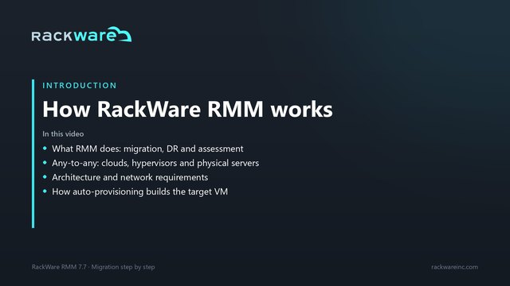
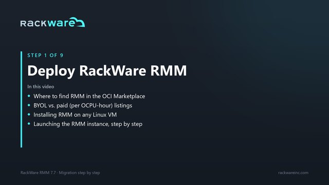
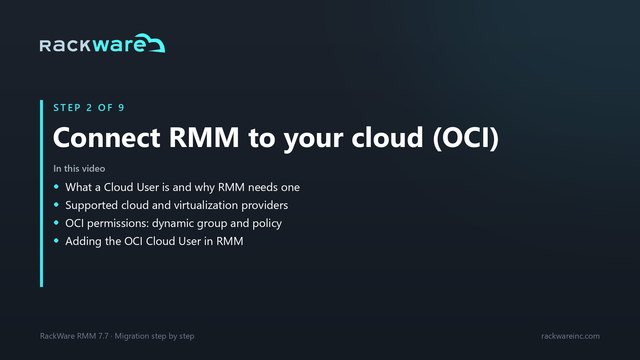
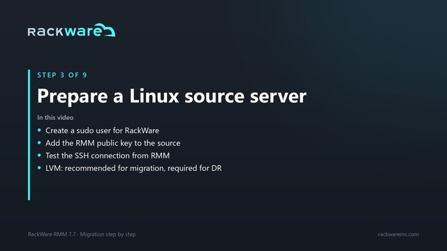
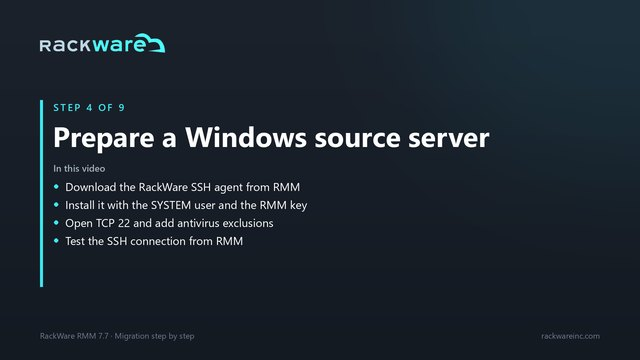
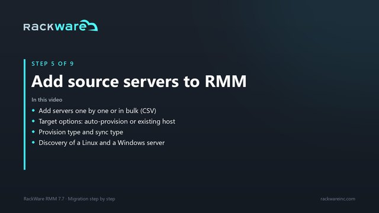
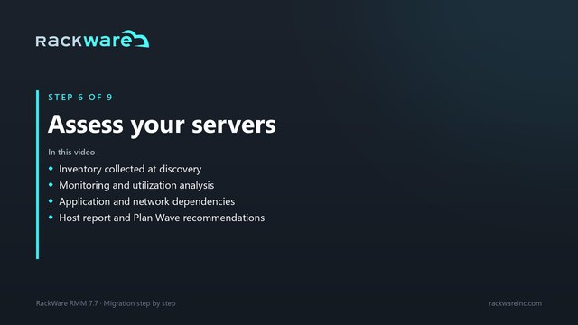
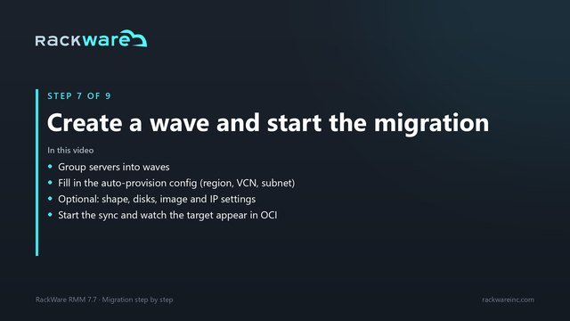
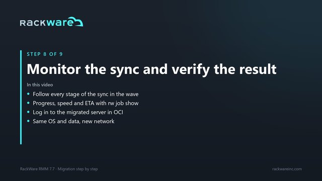
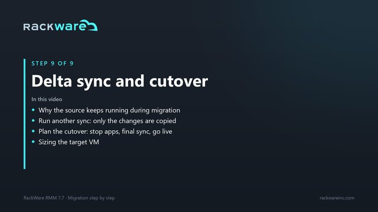

# RackWare RMM 7.7 – Migration step by step

A 10-part video series that takes a new customer from deploying RackWare RMM to cutting over a migrated server.
Recorded in a live lab: Rocky Linux and Windows Server 2022 servers migrated from Google Cloud to Oracle Cloud (OCI). Total running time about 77 minutes, 1080p, with captions.

**Download:** every video is attached to the [migration-series-v1.0 release](https://github.com/rodolfo-rackware/rackware-videos/releases/tag/migration-series-v1.0). Captions (.srt) are in [migration-series/captions](migration-series/captions).

Companion written guide: *RackWare RMM 7.7 – Getting Started Guide* (repository `rackware-docs`).

| | Video | Length | In this video |
|---|---|---|---|
|  | **Intro** [How RackWare RMM works](https://github.com/rodolfo-rackware/rackware-videos/releases/download/migration-series-v1.0/rmm-migration-00-introduction.mp4) | 8:21 | • What RMM does: migration, DR and assessment • Any-to-any: clouds, hypervisors and physical servers • Architecture and network requirements • How auto-provisioning builds the target VM |
|  | **Step 1 of 9** [Deploy RackWare RMM](https://github.com/rodolfo-rackware/rackware-videos/releases/download/migration-series-v1.0/rmm-migration-01-deploy-rmm.mp4) | 4:07 | • Where to find RMM in the OCI Marketplace • BYOL vs. paid (per OCPU-hour) listings • Installing RMM on any Linux VM • Launching the RMM instance, step by step |
|  | **Step 2 of 9** [Connect RMM to your cloud (OCI)](https://github.com/rodolfo-rackware/rackware-videos/releases/download/migration-series-v1.0/rmm-migration-02-connect-cloud.mp4) | 2:31 | • What a Cloud User is and why RMM needs one • Supported cloud and virtualization providers • OCI permissions: dynamic group and policy • Adding the OCI Cloud User in RMM |
|  | **Step 3 of 9** [Prepare a Linux source server](https://github.com/rodolfo-rackware/rackware-videos/releases/download/migration-series-v1.0/rmm-migration-03-prepare-linux-source.mp4) | 9:29 | • Create a sudo user for RackWare • Add the RMM public key to the source • Test the SSH connection from RMM • LVM: recommended for migration, required for DR |
|  | **Step 4 of 9** [Prepare a Windows source server](https://github.com/rodolfo-rackware/rackware-videos/releases/download/migration-series-v1.0/rmm-migration-04-prepare-windows-source.mp4) | 10:33 | • Download the RackWare SSH agent from RMM • Install it with the SYSTEM user and the RMM key • Open TCP 22 and add antivirus exclusions • Test the SSH connection from RMM |
|  | **Step 5 of 9** [Add source servers to RMM](https://github.com/rodolfo-rackware/rackware-videos/releases/download/migration-series-v1.0/rmm-migration-05-add-source-servers.mp4) | 9:53 | • Add servers one by one or in bulk (CSV) • Target options: auto-provision or existing host • Provision type and sync type • Discovery of a Linux and a Windows server |
|  | **Step 6 of 9** [Assess your servers](https://github.com/rodolfo-rackware/rackware-videos/releases/download/migration-series-v1.0/rmm-migration-06-assessment.mp4) | 8:29 | • Inventory collected at discovery • Monitoring and utilization analysis • Application and network dependencies • Host report and Plan Wave recommendations |
|  | **Step 7 of 9** [Create a wave and start the migration](https://github.com/rodolfo-rackware/rackware-videos/releases/download/migration-series-v1.0/rmm-migration-07-wave-and-migration.mp4) | 11:58 | • Group servers into waves • Fill in the auto-provision config (region, VCN, subnet) • Optional: shape, disks, image and IP settings • Start the sync and watch the target appear in OCI |
|  | **Step 8 of 9** [Monitor the sync and verify the result](https://github.com/rodolfo-rackware/rackware-videos/releases/download/migration-series-v1.0/rmm-migration-08-monitor-and-verify.mp4) | 5:00 | • Follow every stage of the sync in the wave • Progress, speed and ETA with rw job show • Log in to the migrated server in OCI • Same OS and data, new network |
|  | **Step 9 of 9** [Delta sync and cutover](https://github.com/rodolfo-rackware/rackware-videos/releases/download/migration-series-v1.0/rmm-migration-09-delta-sync-and-cutover.mp4) | 6:09 | • Why the source keeps running during migration • Run another sync: only the changes are copied • Plan the cutover: stop apps, final sync, go live • Sizing the target VM |

## Notes

- Public IP addresses, account identifiers and credentials visible in the lab recording are blurred.
- The videos are cut from the RackWare webinar of September 30, 2026 (presenter: Rodolfo Silva, RackWare LATAM).
- Captions are also burned into the video; the .srt files are for platforms that support subtitle tracks.

## Updating the series

Videos are rendered outside this repository. To publish a new version: render, update `CHANGELOG.md`, commit, and create a new release (for example `migration-series-v1.1`) with the MP4 files attached.
